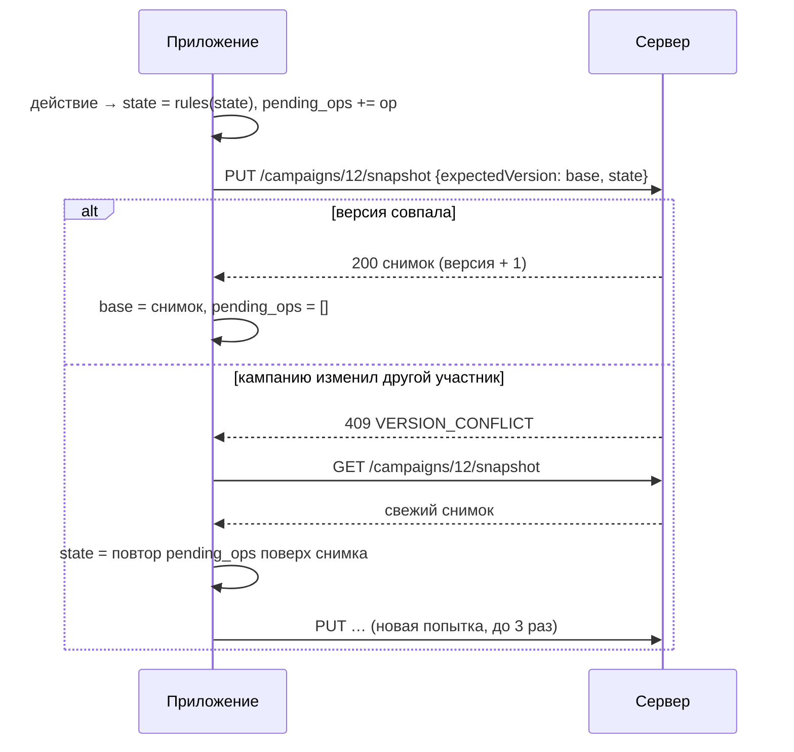

# Primal App — работа с сервером и без сети (версия 1.4)

Приложение повторяет функции сайта (`web/`, описание — `web/doc/behavior.md`), кроме администрирования, и работает
в двух режимах:

| Режим | Что работает |
|-------|--------------|
| **Онлайн** (по умолчанию) | Всё, что без сети, плюс: обновление справочников с сервера, вход и регистрация, кампании аккаунта (свои и открытые по ссылке) — копируются на устройство и синхронизируются, «Поделиться», приглашения по ссылке, живые обновления листа кампании |
| **Офлайн** | Экспедиция, кампании, все справочники (каталог боссов, заданий, глав, достижений, кузни, лаборатории и «Инфо») — из последней загруженной версии или из файлов приложения. Изменения кампаний аккаунта копятся и уходят на сервер при возврате в онлайн |

Режим и адрес сервера задаются в «Настройках». Сервер по умолчанию — `https://primalhelper.ru/`.

---

## 1. Принцип: всё считает приложение

Правила кампании (награды заданий и глав, условные правила, переход главы, кузня, лаборатория, обмен, инвентарь)
выполняются в приложении — перенос сервисов сервера в `shared/commonMain`:

| Сервер (`web/backend`) | Приложение (`shared`) |
|------------------------|----------------------|
| `rules.effects.Effect`, `Condition`, `Decision` | `catalog/Effects.kt` |
| `catalog.EffectParser`, `CatalogLoader` | `catalog/CatalogJson.kt` |
| `rules.effects.EffectPlanner`, `EffectDescriber` | `catalog/EffectPlanner.kt`, `catalog/EffectDescriber.kt` |
| `CampaignService`, `HunterService`, `ForgeService`, `LabService`, `ExchangeService`, `InventoryService`, `QuestService`, `AchievementService`, `BattleResultService`, `ChapterTransitionService`, `ConsequencesWriter`, `PlanApplier`, `BattleSetupService` | `campaign/CampaignRules.kt` |

Поэтому кампания полностью работает без сети, а онлайн приложение отправляет на сервер **готовое состояние**.
Формулировки правил и тексты окон («Добавлено задание 4.», «Не будет добавлено задание 4.») совпадают с сайтом.

---

## 2. Справочники

| Справочник | С сервера | Без сети / до первой загрузки |
|------------|-----------|--------------------------------|
| Каталог: боссы и стойки, задания, главы (эффекты в языке эффектов), достижения, кузня, лаборатория | `GET /api/v1/catalog/bundle` с `If-None-Match` (ETag — контрольная сумма каталога, правки администратора видны сразу) | кэш `cache_blob["catalog"]`; файл приложения `androidApp/src/main/assets/catalog-bundle.json` |
| «Инфо»: ключевые слова, символы реакций, жетоны окружения | `GET /api/v1/info` (ETag) и картинки `GET /api/v1/info/images/{id}` — скачиваются заранее | кэш `cache_blob["info"]`, `cache_blob["img:…"]`; файл `default-info.json` (картинки внутри, Base64) |

Обновление — при запуске, при возврате приложения на экран, раз в минуту и по кнопке «Синхронизировать»
(`SyncEngine.sync(references = true)`). Неразобранный ответ не заменяет действующий каталог. Файлы по умолчанию
обновляются при выпуске версии: каталог — ответом `GET /api/v1/catalog/bundle` локального сервера без правок
администратора, «Инфо» — `web/backend/src/main/resources/info/default-info.json`.

---

## 3. Хранение на устройстве (Room, версия БД 19)

| Таблица | Содержимое |
|---------|-----------|
| `campaign_store` | Кампания — документ JSON `CampaignState` (`state_json`) и синхронизация: `server_id`, `account` (`<сервер>\|u<id>` или `\|d<устройство>` у гостя), `access` (`LOCAL`/`OWNER`/`LINK`), `base_version` и `base_json` — последний снимок сервера, `pending_ops` — журнал действий после него, `pending_delete`, `upload`, `sync_message`, `main_hunter` — основной персонаж этого входа (код класса), `main_hunter_dirty` — выбор ещё не отправлен на сервер |
| `kv_store` | Настройки: `mode`, `server`, `account` (JSON), `cookies` (JSON), `localExpansions`, `lastSync` |
| `cache_blob` | Справочники с сервера и картинки «Инфо» с ETag |

`CampaignState` повторяет снимок сервера (`web/doc/api.md` §11): глава книги 0–11 («Пролог» — 0), статус
(`ACTIVE`, `CHAPTER_TRANSITION`, `COMPLETED`), кузня и лаборатория, финальный босс, `progressSeq`, заметки, охотники
(навыки, ресурсы, инвентарь), задания со статусом (`OPEN`, `COMPLETED`, `EXPIRED`), достижения с кодом каталога,
трофеи, история боёв.

**Миграция 17→18** (`database/Migration18.kt`) переносит кампании версий 1.0–1.2: глава = `current_chapter − 1`,
задания — выполнено / открыто / истекло (`is_available = 0`), достижения и боссы трофеев — по кодам каталога
(`LegacyCatalogCodes.kt`, написание приводится к каталогу), навыки — только открытые ступени (ступень 2 без ступени 1
отбрасывается). Инвентаря у старых кампаний нет — как у кампаний сайта, созданных до инвентаря. Старые таблицы
удаляются; миграции 1–17 сохранены, чтобы обновление шло с любой версии.

**Миграция 18→19** добавляет `main_hunter` и `main_hunter_dirty`: у кампаний основной персонаж не выбран.

---

## 4. Вход

- «Настройки» → «Вход» (логин и пароль) или «Регистрация» (логин, пароль, повтор, имя) — `POST /auth/login`,
  `POST /auth/register`, затем `GET /auth/me`.
- Сессия — cookie устройства `PRIMAL_DEVICE`, как у браузера; `CookieJar` хранит cookie в `kv_store`, учитывает
  домен, путь, срок и `Secure`. Изменяющие запросы несут CSRF-токен: заголовок `X-XSRF-TOKEN` из cookie `XSRF-TOKEN`
  (нет cookie — сначала `GET /auth/csrf`).
- Гость: приглашение по ссылке без входа создаёт гостевое устройство (как на сайте). Вход после этого переносит доступы
  гостя в аккаунт; копии кампаний гостя переходят к аккаунту (`CampaignStore.reassign`; если такая кампания у аккаунта
  уже есть — копия гостя убирается).
- «Выйти» — `POST /auth/logout` (без сети выход всё равно выполняется), забываются аккаунт и cookie
  (`AppCore.forgetAccount`). **Кампании остаются на устройстве**, включая неотправленные изменения: копия по-прежнему
  относится к аккаунту (`account` — ключ `<сервер>|u<id>`), не синхронизируется без входа и снова синхронизируется
  после входа в тот же аккаунт (журнал действий не теряется). Подтверждения нет.
- Смена адреса сервера — как выход: вход относится к серверу, копии кампаний прежнего сервера остаются.
- `401` при синхронизации — «Вход на сервере больше не действует — войдите снова».

---

## 5. Кампании и синхронизация

### 5.1 Какие кампании на устройстве

| `access` | Откуда | Удаление |
|----------|--------|----------|
| `LOCAL` | Создана в приложении (в том числе до версии 1.3) и ещё не на сервере | с устройства |
| `OWNER` | Своя кампания на сервере (создана на сайте, в приложении после входа или загружена) | на сервере и у всех участников (без сети — при следующей синхронизации) |
| `LINK` | Открыта по ссылке-приглашению | нельзя (как на сайте) |

Список кампаний показывает все кампании устройства: «только на устройстве», копии текущего аккаунта и копии, оставшиеся
после выхода (или от другого аккаунта/сервера) — «· синхронизируется после входа в аккаунт». Такие копии открываются и
меняются (действия копятся в журнале), синхронизируются только при входе в их аккаунт; удаляются только с устройства.
Кампания, созданная после входа,
загружается на сервер автоматически (`POST /campaigns/import`); старые и созданные без входа — кнопкой «Загрузить
на сервер» в списке. Лимит сервера — 10 своих кампаний: при отказе кампания остаётся на устройстве с пояснением.

### 5.2 Действия — журнал

Каждое действие игрока — объект `CampaignOp` (`campaign/CampaignOps.kt`): ресурсы, навыки, кузня, лаборатория,
инвентарь, обмен, задания, достижения, заметки, глава, отметка о начале боя, итог боя, переход главы. Действие
сразу выполняется по правилам (`CampaignRules`) над текущим состоянием; у кампании с сервера оно ещё и
дописывается в `pending_ops`. Недопустимое действие (не хватает ресурсов, ступень 2 без ступени 1…) — сообщение,
кампания не меняется.

### 5.3 Отправка и конфликты

- Правки разных устройств складываются: ресурсы, задания, достижения других участников не затираются — журнал
  повторяется поверх их состояния (`CampaignStore.replay`).
- **Первая принятая победа закрывает главу** (как на сайте): если пока шёл бой другой участник принял победу или
  сменил главу, итог боя при повторе записывается **отклонённым** и игрок получает сообщение «Результат боя не
  принят: Глава 1 уже завершена: принята победа в бою с боссом «Озев» (результат от: Вадим)… Награды можно внести
  вручную.» Перед окном наград онлайн-приложение обновляет кампанию с сервера — обычно это видно сразу.
- Остальные действия, недопустимые на свежем снимке, отбрасываются с сообщением «Изменение не применено: …».
- Сервер не принял состояние (`400`, `422`) — берётся версия сервера, на листе кампании — пояснение.
- Несколько действий подряд уходят одним запросом (задержка 1,5 с). Действия, сделанные во время отправки,
  остаются в журнале и уходят следующим запросом.

### 5.4 Получение

- Список `GET /campaigns`; новые кампании копируются (`GET …/snapshot`), у остальных — условный запрос с
  `If-None-Match: "v<версия>"` (`304`, если не менялась). Кампании, которых в списке больше нет (удалены, доступ закрыт),
  убираются с устройства с сообщением.
- Открытый лист онлайн-кампании подписан на поток событий `GET /campaigns/{id}/events` (SSE): `campaign.updated` —
  кампания обновляется сразу, `access.revoked` — полная синхронизация. При обрыве — переподключение через 5 с.
- Бой кампании: отметка о начале (`BattleRecord` со статусом `IN_PROGRESS`) уходит со снимком — другие участники
  видят «Идёт бой». Итог боя записывается в историю (`APPLIED`/`DISMISSED`), брошенный бой — `ABANDONED`.

### 5.5 Основной персонаж

Основной персонаж — свой у каждого входа (web qa № 150), это не часть кампании: в снимок и журнал не попадает.
- Выбор в листе (`CampaignStore.setMainHunter`) пишется в `main_hunter` с `main_hunter_dirty = 1` и запускает
  синхронизацию: после кампаний `SyncEngine.syncMainHunters` отправляет его (`PUT /campaigns/{id}/main-hunter`) и
  снимает отметку. Отказ сервера (охотника нет в отряде) — остаётся выбор сервера.
- Выбор, сделанный на сайте или на другом устройстве, приходит в списке кампаний (`mainHunter` у
  `GET /campaigns`) и применяется, если свой выбор не ждёт отправки. Снимок кампании для этого не годится: его
  ETag зависит только от версии кампании.
- Записи копии с сервера (`CampaignStore.updateEntity`) основного персонажа не трогают.
- Кампания только на устройстве хранит выбор у себя; после загрузки на сервер он уходит при синхронизации.

---

## 6. Совместная игра

Кнопки «Поделиться» и «Ссылка на сайт» на листе есть у любой кампании, со входом и без
(`CampaignSheetViewModel.onShareOpened`, `onSiteLink`, окна `SheetPrompt`):

- **Поделиться** (владелец, онлайн-кампания): «Создать ссылку», ссылка и QR-код, «Отправить» (системное окно
  «Поделиться»), «Копировать», «Присоединились:», «Перевыпустить» и «Отозвать» с подтверждением —
  `GET/POST/DELETE /campaigns/{id}/share-link`. Без входа (и в офлайн-режиме) — окно «Чтобы поделиться кампанией,
  войдите в аккаунт.» с «Войти» → экран входа (`Screen.Login`). Кампания только на устройстве — «Загрузить» (загрузка
  и сразу окно ссылки-приглашения); кампания по ссылке или другого аккаунта — подсказка.
- **Ссылка на сайт** — адрес листа кампании на сайте (`<сервер копии>/campaigns/<id>`) для участников, у которых уже
  есть доступ; вход для этого не нужен. Кампания только на устройстве — предложение войти или загрузить её.
- **Приглашение**: ссылка `https://primalhelper.ru/s/<токен>` открывается в приложении (App Links, раздел 7) —
  «Вас пригласили в кампанию «…»» и окно «Кто вы в этой кампании?» с охотниками отряда (`GET /share/{token}` →
  `hunters`): выбор — `POST /share/{token}/join` с `hunterClass`, персонаж становится основным (§5.5), у гостя без
  имени имя игрока — имя в истории боёв; затем лист кампании. Сервер, не присылающий отряд, — как раньше: имя
  гостя и «Присоединиться». Ссылки другого сервера — подсказка указать его в настройках.

---

## 7. Сайт и приложение (Android)

- **App Links**: `AndroidManifest.xml` — фильтр с `autoVerify` для `https://primalhelper.ru/s/…` и
  `/campaigns…`; сайт подтверждает связь файлом `/.well-known/assetlinks.json` (пакет `com.primalapp.android` и
  SHA-256 сертификата подписи выпуска). Ссылки на эти страницы из мессенджеров открываются сразу в приложении.
- Второй фильтр (без проверки) принимает любую страницу сайта — для кнопки сайта «Продолжить в приложении»;
  страница без своего экрана открывает главное меню.
- **Публикация**: RuStore, «Companion PA» (`https://www.rustore.ru/catalog/app/com.primalapp.android`). Обновление
  подписывается тем же ключом, что и опубликованная версия (отпечаток — в `assetlinks.json`), и с большим
  `versionCode`. Версии 1.0–1.2 (`versionCode` 1–3) не объявляют связь с сайтом и не принимают ссылки: сайт их не
  видит и открыть не может — только через обновление до 1.3.
- **Предложение на сайте** (`web/frontend/src/shared/ui/OpenInAppBanner.tsx`): на Android, в браузере (не в
  установленном PWA), в режиме онлайн. Установку проверяет `navigator.getInstalledRelatedApps()` (Chrome на Android):
  у сайта в манифесте PWA — `related_applications` (платформа `play` — любое приложение Android, в том числе из
  RuStore; `com.primalapp.android`), у приложения — `asset_statements` со ссылкой на `assetlinks.json`.
  - Найдено — «На этом телефоне установлено приложение «Companion PA» — продолжите в нём.», кнопка «Продолжить в
    приложении» — `intent://…#Intent;scheme=https;package=com.primalapp.android;S.browser_fallback_url=<страница>;end`.
    Отказ («Остаться на сайте») — до конца сеанса браузера.
  - Не найдено (нет приложения, версия до 1.3, браузер без проверки) — пояснение про RuStore и та же кнопка, но
    `browser_fallback_url` — страница RuStore: 1.3+ откроется, иначе игрок попадёт в RuStore (установить или
    обновить). Отказ — на 30 дней.

---

## 8. Сервер: что добавлено для приложения

| Запрос | Назначение |
|--------|-----------|
| `GET /api/v1/catalog/bundle` | Каталог целиком с эффектами в исходном виде (`web/doc/api.md` §4.1) |
| `GET /api/v1/campaigns/{id}/snapshot` | Снимок кампании с версией (ETag `"v<версия>"`) |
| `PUT /api/v1/campaigns/{id}/snapshot` | Запись снимка с `expectedVersion`; бои дописываются к истории |
| `POST /api/v1/campaigns/import` | Кампания из приложения — на сервер |

Подробно — `web/doc/api.md` §11.
